# Lookbk free skills

38 free agent skills from [Lookbk](https://lookbk.dev/?utm_source=github&utm_medium=repo&utm_campaign=free-skills-readme) that make visual work: a kinetic title video, an 8-bit promo, a slide deck, link-preview images, an architecture diagram, two landing pages, 24 Page Kits that build website sections and whole pages (pricing, FAQ, footer, contact, booking, a shop, a journal, a portfolio and more), and seven animated hero sections. Each one is a folder with a `SKILL.md` that Claude Code, Codex, Cursor, GitHub Copilot, Gemini CLI, OpenCode and other agents can follow, plus the scripts and templates it runs.

Every picture below was rendered by the skill itself. The skills run on your own machine: none of them calls an AI model or asks for an API key.

| | |
| :-: | :-: |
| [](#kinetic-title-drop) | [](#pixel-quest-promo) |
| [](#swiss-grid-deck) | [](#editorial-og-card) |
| [](#blueprint-architecture-diagram) | [](#mono-editorial-landing) |
| [](#waitlist-glow) | [](#washing-line-hero) |
| [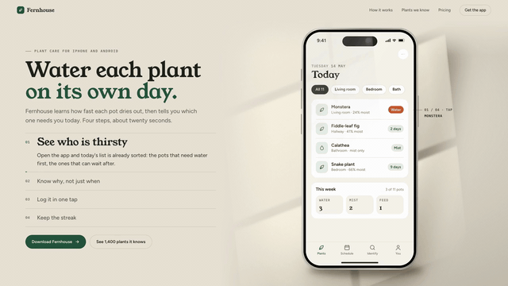](#phone-screen-showcase) | [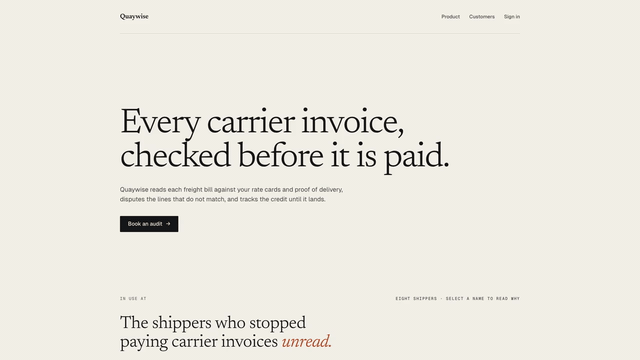](#proof-band) |
| [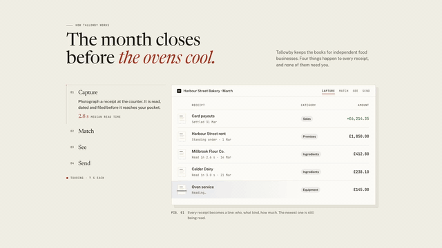](#feature-tabs) | [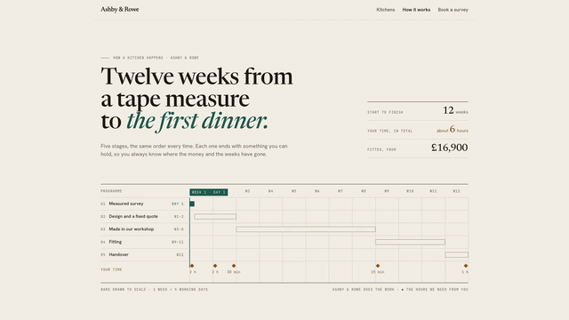](#how-it-works) |
| [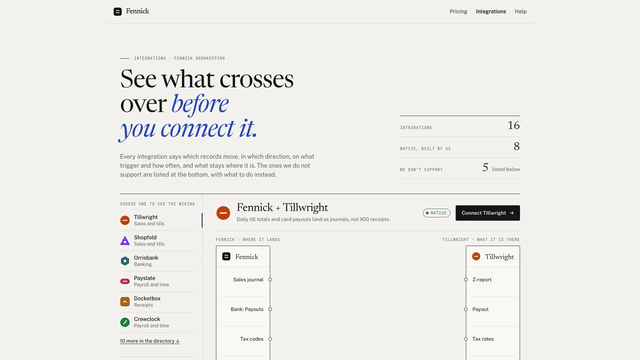](#integrations) | [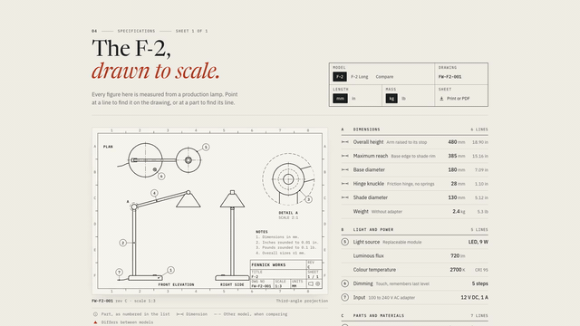](#spec-sheet) |
| [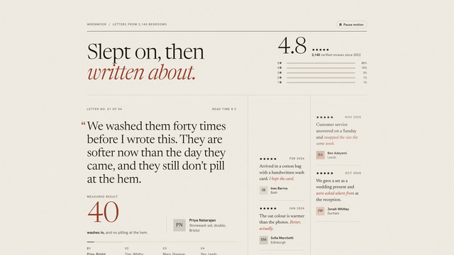](#testimonial-wall) | [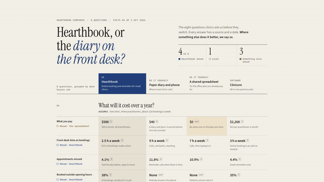](#honest-comparison) |
| [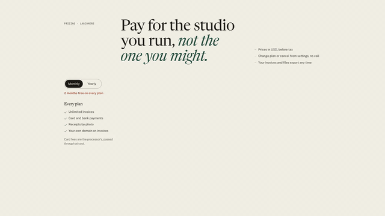](#pricing-kit) | [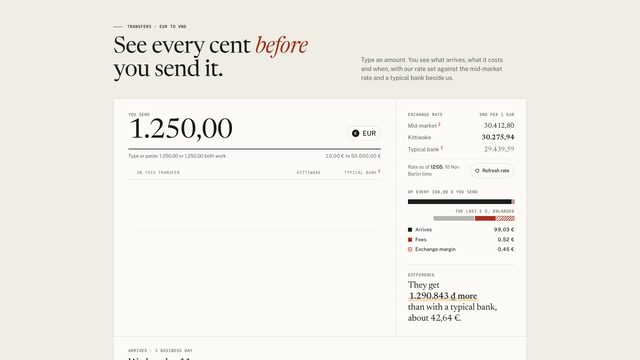](#fee-calculator) |
| [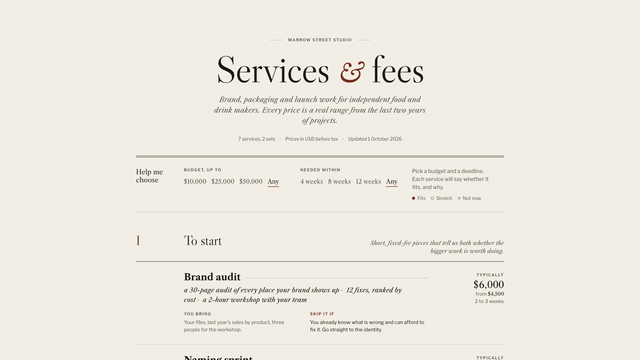](#services-menu-kit) | [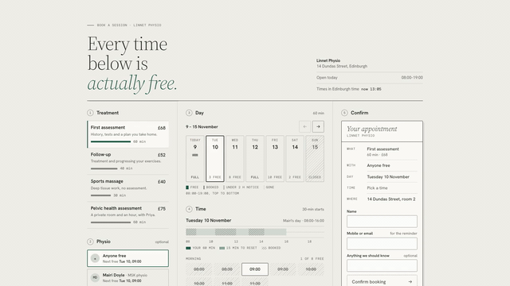](#booking-slots) |
| [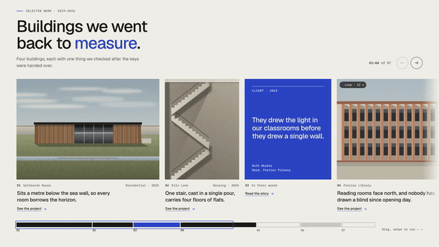](#story-rail) | [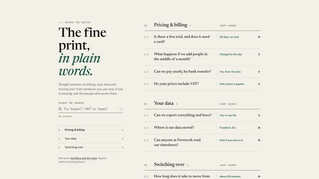](#faq-kit) |
| [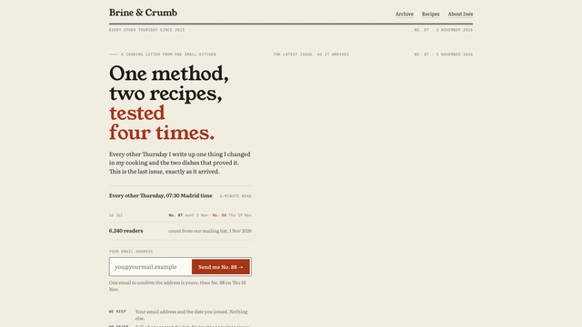](#newsletter-signup) | [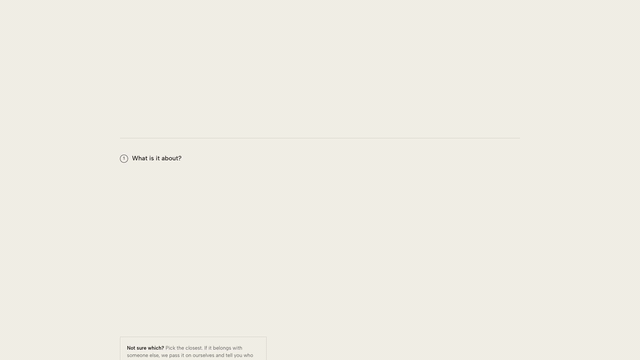](#contact-desk) |
| [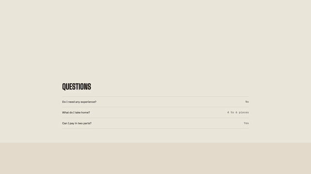](#closing-cta-kit) | [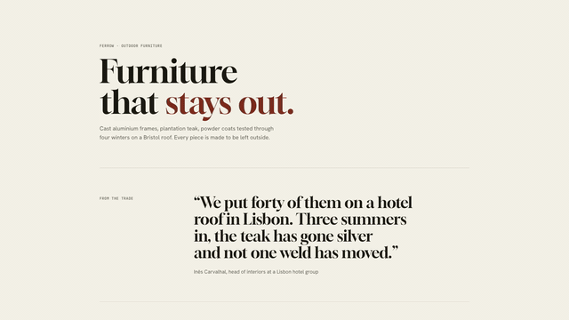](#footer-kit) |
| [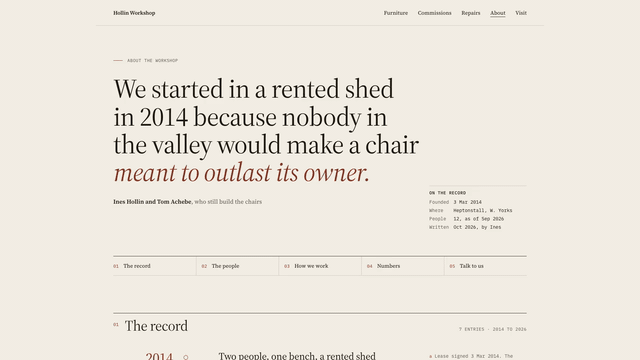](#about-page) | [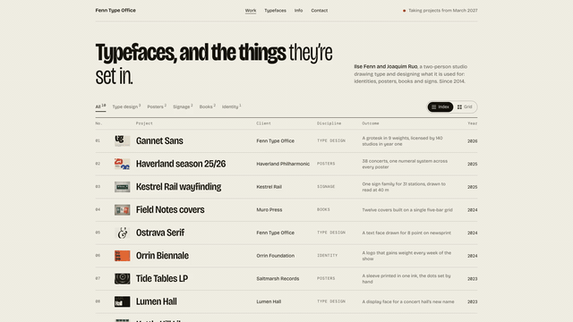](#work-index) |
| [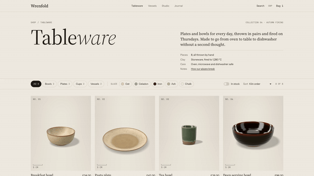](#shop-collection) | [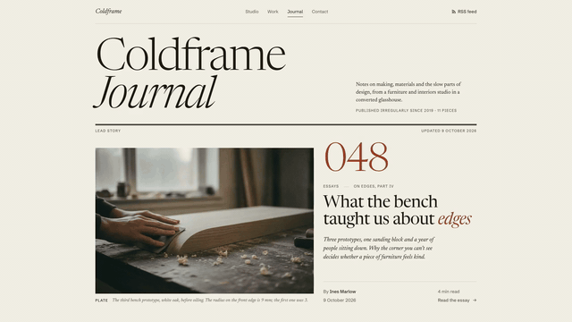](#journal-index) |
| [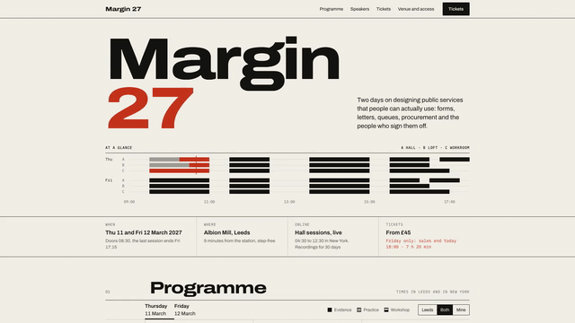](#event-page) | [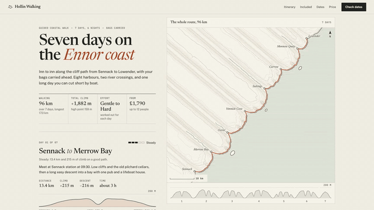](#trip-itinerary) |
| [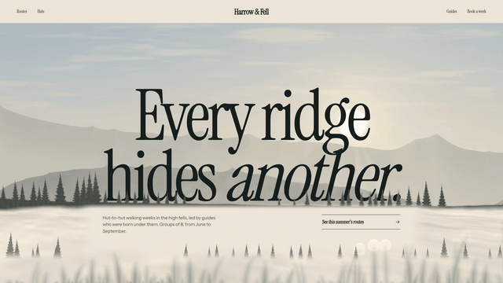](#parallax-depth) | [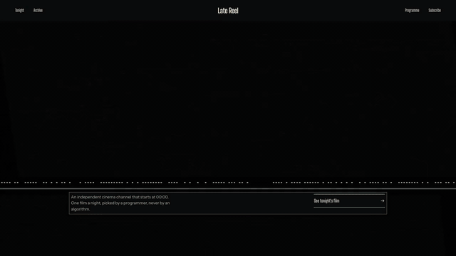](#signal-glitch) |
| [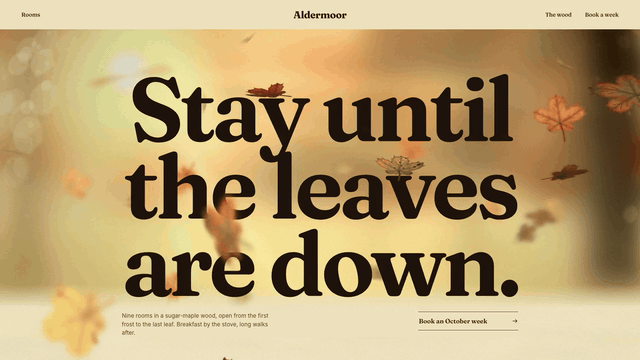](#falling-leaves) | [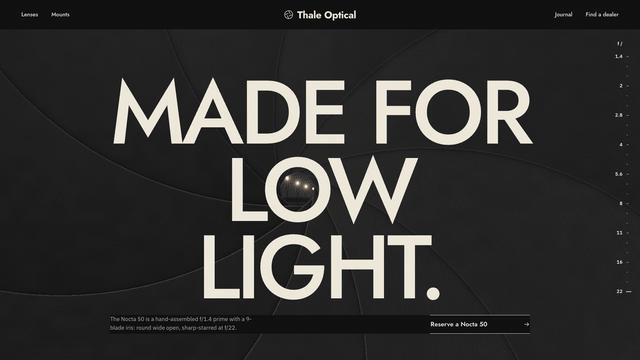](#aperture-reveal) |
| [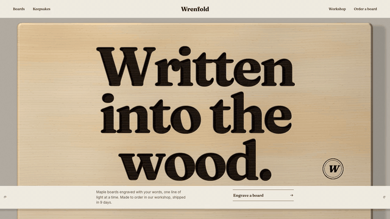](#laser-etch) | [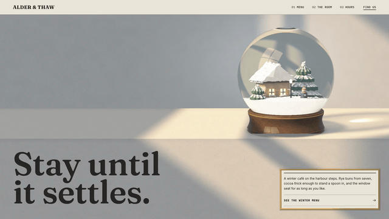](#snow-globe) |

## Install

### Any agent: the `skills` CLI

```bash
npx skills add lookbkdev/lookbk-skills
```

It lists the 38 skills, asks which ones and which agents to install them for, and copies them into each agent's skills folder. Add `-g` to install for every project instead of the current one. To skip the questions:

```bash
npx skills add lookbkdev/lookbk-skills --skill kinetic-title-drop -a claude-code -g -y
```

The CLI needs Node.js 22.20 or later. It sends anonymous install counts to [skills.sh](https://skills.sh); set `DISABLE_TELEMETRY=1` to turn that off.

### Claude Code: plugin marketplace

Inside a Claude Code session:

```
/plugin marketplace add lookbkdev/lookbk-skills
/plugin install lookbk@lookbk-skills
```

`lookbk` installs all 38 skills. Their commands carry the plugin name, such as `/lookbk:kinetic-title-drop`, and Claude also uses them when you simply ask for the thing. To install one skill instead, use its name, for example `/plugin install swiss-grid-deck@lookbk-skills`. Install either the bundle or single skills, not both.

From your shell, the same steps are `claude plugin marketplace add lookbkdev/lookbk-skills` and `claude plugin install lookbk@lookbk-skills`. On Claude Code 2.1.275 or later, one line does both:

```
/plugin install lookbk --marketplace lookbkdev/lookbk-skills
```

### Cursor

```bash
npx skills add lookbkdev/lookbk-skills -a cursor -g
```

Or copy skill folders by hand: Cursor reads `.agents/skills/` and `.cursor/skills/` in a project, and `~/.agents/skills/` and `~/.cursor/skills/` for every project. It also reads the Claude Code and Codex skill folders.

### Codex

```bash
npx skills add lookbkdev/lookbk-skills -a codex -g
```

Or copy skill folders by hand: Codex reads `.agents/skills/` in your repository and `~/.agents/skills/` for every project.

### By hand

A skill is installed when its folder, with `SKILL.md` directly inside it, sits in a folder your agent reads. Keep the folder name the same as the skill's name.

```bash
git clone https://github.com/lookbkdev/lookbk-skills.git
mkdir -p ~/.claude/skills ~/.agents/skills
cp -r lookbk-skills/skills/* ~/.claude/skills/    # Claude Code
cp -r lookbk-skills/skills/* ~/.agents/skills/    # Codex, Cursor, Gemini CLI, Copilot, OpenCode
```

Start a new agent session afterwards so the agent loads the skills. In Claude Code, `/skills` lists what it found.

### Or the Lookbk installer

```bash
curl -fsSL https://lookbk.dev/cli.js | node - add kinetic-title-drop
```

It writes the current version from lookbk.dev to the folders your agents read; run it again to update. The first run prints a sign-in link for a free Lookbk account. Add `--project` to install into the current repository, or `--claude` or `--shared` to write one folder only.

## The skills

Ask your agent in plain words. The agent reads the skill's `SKILL.md`, asks for what it needs (your words, colours, notes or repository), runs the skill's own build and checks, and hands you the files.

### Videos, slides and images

#### Kinetic Title Drop

[](https://lookbk.dev/skills/kinetic-title-drop?utm_source=github&utm_medium=repo&utm_campaign=free-skills-readme)

A six-second, 1920×1080 kinetic type video (MP4) in three beats, for launch openers, release announcements and social posts. You give it three short lines, a chip, a footer and three colours.

- **Needs:** Node.js 22+, FFmpeg
- **Try:** *Make a 6-second kinetic title drop that says "Ship / it / today." in our brand orange, 1080p, for an X post.*
- [`skills/kinetic-title-drop`](skills/kinetic-title-drop) · [Preview and details on lookbk.dev](https://lookbk.dev/skills/kinetic-title-drop?utm_source=github&utm_medium=repo&utm_campaign=free-skills-readme)

#### Pixel Quest Promo

[](https://lookbk.dev/skills/pixel-quest-promo?utm_source=github&utm_medium=repo&utm_campaign=free-skills-readme)

A 20-second 8-bit promo video (MP4, 1080p): a title screen, three platformer stages where a pixel hero collects coins for one feature each, and an ending with your headline and link, all on a 120 BPM grid. It also writes a cue sheet for adding chiptune music.

- **Needs:** Node.js 22+, FFmpeg
- **Try:** *Make a 20-second Pixel Quest promo for our side project launch with the line "LEVEL UP your notes".*
- [`skills/pixel-quest-promo`](skills/pixel-quest-promo) · [Preview and details on lookbk.dev](https://lookbk.dev/skills/pixel-quest-promo?utm_source=github&utm_medium=repo&utm_campaign=free-skills-readme)

#### Swiss Grid Deck

[](https://lookbk.dev/skills/swiss-grid-deck?utm_source=github&utm_medium=repo&utm_campaign=free-skills-readme)

A slide deck in the Swiss grid style from your outline or notes: an HTML deck that presents in the browser, a PDF, and an editable PowerPoint file (PPTX) with speaker notes.

- **Needs:** Node.js 18+, Chrome
- **Try:** *Turn notes.md into a 12-slide Swiss Grid deck for our board meeting, with speaker notes, and export PDF and PPTX.*
- [`skills/swiss-grid-deck`](skills/swiss-grid-deck) · [Preview and details on lookbk.dev](https://lookbk.dev/skills/swiss-grid-deck?utm_source=github&utm_medium=repo&utm_campaign=free-skills-readme)

#### Editorial OG Card

[](https://lookbk.dev/skills/editorial-og-card?utm_source=github&utm_medium=repo&utm_campaign=free-skills-readme)

1200×630 link-preview images (PNG) for every blog post, doc or newsletter in one editorial look, with the headline set as real text, and the site's meta tags wired up.

- **Needs:** Node.js 18+, Chrome
- **Try:** *Make Editorial OG cards for every post in /content/blog and save them next to each post.*
- [`skills/editorial-og-card`](skills/editorial-og-card) · [Preview and details on lookbk.dev](https://lookbk.dev/skills/editorial-og-card?utm_source=github&utm_medium=repo&utm_campaign=free-skills-readme)

#### Blueprint Architecture Diagram

[](https://lookbk.dev/skills/blueprint-architecture?utm_source=github&utm_medium=repo&utm_campaign=free-skills-readme)

A system architecture diagram drawn like an engineering sheet, from a description or by reading your repository, laid out automatically with moving data-flow dots. Outputs an HTML page, an SVG and a PNG.

- **Needs:** Node.js 18+, Chrome for the PNG
- **Try:** *Read this repo and draw a Blueprint architecture diagram of the order service, with data flow animated.*
- [`skills/blueprint-architecture`](skills/blueprint-architecture) · [Preview and details on lookbk.dev](https://lookbk.dev/skills/blueprint-architecture?utm_source=github&utm_medium=repo&utm_campaign=free-skills-readme)

### Landing pages

#### Mono Editorial Landing

[](https://lookbk.dev/skills/mono-editorial-landing?utm_source=github&utm_medium=repo&utm_campaign=free-skills-readme)

A black-and-white landing page set like a magazine, drafted from your README, as one responsive HTML file with a waitlist form that really signs people up. It checks layout, contrast and accessibility in headless Chrome.

- **Needs:** Node.js 18+, Chrome for the checks
- **Try:** *Build a Mono Editorial landing page for quietly.example from our README, with a waitlist form.*
- [`skills/mono-editorial-landing`](skills/mono-editorial-landing) · [Preview and details on lookbk.dev](https://lookbk.dev/skills/mono-editorial-landing?utm_source=github&utm_medium=repo&utm_campaign=free-skills-readme)

#### Waitlist Glow

[](https://lookbk.dev/skills/waitlist-glow?utm_source=github&utm_medium=repo&utm_campaign=free-skills-readme)

A one-screen waitlist or coming-soon page with a breathing gradient glow, one email field that posts to Formspree, Netlify Forms, Buttondown, Mailchimp or your own endpoint, and an optional countdown. The sign-up is tested end to end in Chrome before it goes live.

- **Needs:** Node.js 18+, Chrome, a form service
- **Try:** *Make a Waitlist Glow page for soon.example that posts emails to our Formspree form, with a countdown to December 1.*
- [`skills/waitlist-glow`](skills/waitlist-glow) · [Preview and details on lookbk.dev](https://lookbk.dev/skills/waitlist-glow?utm_source=github&utm_medium=repo&utm_campaign=free-skills-readme)

### Page Kits: sections

Each builds one section of a website from a single JSON file, as a page and a paste-in embed, checks it in headless Chrome at phone and desktop widths, and records a 1080p preview video.

#### Phone Screen Showcase

[](https://lookbk.dev/skills/phone-screen-showcase?utm_source=github&utm_medium=repo&utm_campaign=free-skills-readme)

The hero of a mobile app's landing page: one phone, drawn in HTML and CSS, walks through 3 to 5 screens of your app tap by tap. A fingertip ring lands beside what to tap, the next screen pushes, rises or switches like the real app, and numbered chapters beside the phone fill a progress bar as visitors scroll. Screens come from your screenshots or a short JSON list.

- **Needs:** Node.js 18+, Chrome, FFmpeg for the video
- **Try:** *Build our app landing page hero with one phone that walks through four screens of our plant care app, tap by tap, from these screenshots.*
- [`skills/phone-screen-showcase`](skills/phone-screen-showcase) · [Live demo, preview and details on lookbk.dev](https://lookbk.dev/skills/phone-screen-showcase?utm_source=github&utm_medium=repo&utm_campaign=free-skills-readme)

#### Proof Band

[](https://lookbk.dev/skills/proof-band-kit?utm_source=github&utm_medium=repo&utm_campaign=free-skills-readme)

The band under a hero that says who uses the product: customer logos measured from their SVGs and sized to the same visual weight on one baseline, and figures in tabular numerals, each with a note giving its source and as-of date. The build refuses a figure without a source.

- **Needs:** Node.js 18+, Chrome, FFmpeg for the video
- **Try:** *Build the trusted-by band under our hero from these SVG logos, with three figures and a note giving the source and date of each.*
- [`skills/proof-band-kit`](skills/proof-band-kit) · [Live demo, preview and details on lookbk.dev](https://lookbk.dev/skills/proof-band-kit?utm_source=github&utm_medium=repo&utm_campaign=free-skills-readme)

#### Feature Tabs

[](https://lookbk.dev/skills/feature-tabs-kit?utm_source=github&utm_medium=repo&utm_campaign=free-skills-readme)

A features section with 3 to 6 tabs beside one stage drawn as real interface: a list, a chart, an email, a form or a timeline built from your config. Switching tabs moves the same objects into the next view, and the build checks that totals and prices agree across views.

- **Needs:** Node.js 18+, Chrome, FFmpeg for the video
- **Try:** *Build our features section with four tabs, each with a claim, a proof number and a view of our product made from the same records.*
- [`skills/feature-tabs-kit`](skills/feature-tabs-kit) · [Live demo, preview and details on lookbk.dev](https://lookbk.dev/skills/feature-tabs-kit?utm_source=github&utm_medium=repo&utm_campaign=free-skills-readme)

#### How It Works

[](https://lookbk.dev/skills/process-steps-kit?utm_source=github&utm_medium=repo&utm_campaign=free-skills-readme)

The process section of a service, set as the schedule page of a proposal: 3 to 7 steps drawn to scale on one calendar, saying who does what, how long it takes, what the buyer gives, gets and pays, and the hours the buyer is needed. The build checks that the schedule, hours and payments add up.

- **Needs:** Node.js 18+, Chrome, FFmpeg for the video
- **Try:** *Build a how-it-works section for our kitchen fitting service: five steps on a 12-week schedule, with the client's hours and the payment at each step.*
- [`skills/process-steps-kit`](skills/process-steps-kit) · [Live demo, preview and details on lookbk.dev](https://lookbk.dev/skills/process-steps-kit?utm_source=github&utm_medium=repo&utm_campaign=free-skills-readme)

#### Integrations

[](https://lookbk.dev/skills/integrations-kit?utm_source=github&utm_medium=repo&utm_campaign=free-skills-readme)

An integrations section and directory that shows what actually syncs instead of a wall of logos. Pick an app and its wiring draws itself: one wire per record with direction, trigger and cadence, what never crosses and why, setup steps with minutes, then a searchable directory and an honest not-supported list.

- **Needs:** Node.js 18+, Chrome, FFmpeg for the video
- **Try:** *Build our integrations page from our docs: for each app, the records that sync, which way and how often, what stays behind, and the setup steps.*
- [`skills/integrations-kit`](skills/integrations-kit) · [Live demo, preview and details on lookbk.dev](https://lookbk.dev/skills/integrations-kit?utm_source=github&utm_medium=repo&utm_campaign=free-skills-readme)

#### Spec Sheet

[](https://lookbk.dev/skills/spec-sheet-kit?utm_source=github&utm_medium=repo&utm_campaign=free-skills-readme)

The technical specifications section of a hardware product page, drawn as an engineering drawing with its spec table: orthographic views, dimension lines and numbered balloons that light up the matching table line. Units switch between metric and imperial, up to 3 models compare side by side, and the build checks every drawn dimension against the table.

- **Needs:** Node.js 18+, Chrome, FFmpeg for the video
- **Try:** *Build the specifications section for our desk lamp as an engineering drawing, with a spec table in mm and inches.*
- [`skills/spec-sheet-kit`](skills/spec-sheet-kit) · [Live demo, preview and details on lookbk.dev](https://lookbk.dev/skills/spec-sheet-kit?utm_source=github&utm_medium=repo&utm_campaign=free-skills-readme)

#### Testimonial Wall

[](https://lookbk.dev/skills/testimonial-wall?utm_source=github&utm_medium=repo&utm_campaign=free-skills-readme)

A social-proof section set like a newspaper's letters page: your rating with its real star distribution, a lead quote with the result that customer got, a slow wall of reviews paced by reading time, case cards with before and after figures, and a press strip. The build refuses a score the stars don't average to.

- **Needs:** Node.js 18+, Chrome, FFmpeg for the video
- **Try:** *Build a testimonial section for our landing page from our real reviews: the rating with its star breakdown, a featured quote, a slow review wall and press quotes.*
- [`skills/testimonial-wall`](skills/testimonial-wall) · [Live demo, preview and details on lookbk.dev](https://lookbk.dev/skills/testimonial-wall?utm_source=github&utm_medium=repo&utm_campaign=free-skills-readme)

#### Honest Comparison

[](https://lookbk.dev/skills/compare-table-kit?utm_source=github&utm_medium=repo&utm_campaign=free-skills-readme)

The comparison section of a vs or alternatives page, set as a fact-checked brief: your product beside 2 to 4 alternatives, every cell a short fact with a numbered source and date instead of a tick, a plain verdict on every row and the rows you lose printed like the ones you win.

- **Needs:** Node.js 18+, Chrome, FFmpeg for the video
- **Try:** *Build a comparison section for our booking app against a paper diary, a spreadsheet and one competitor, every cell a sourced fact.*
- [`skills/compare-table-kit`](skills/compare-table-kit) · [Live demo, preview and details on lookbk.dev](https://lookbk.dev/skills/compare-table-kit?utm_source=github&utm_medium=repo&utm_campaign=free-skills-readme)

#### Pricing Kit

[](https://lookbk.dev/skills/pricing-kit?utm_source=github&utm_medium=repo&utm_campaign=free-skills-readme)

A pricing section where every plan hangs from one shared price scale. The monthly and yearly switch rolls each price digit by digit and shows the money kept, the recommended plan is set apart with a reason, a comparison opens out of the cards, and an optional usage calculator names the cheapest plan.

- **Needs:** Node.js 18+, Chrome, FFmpeg for the video
- **Try:** *Build our pricing section with our three plans, monthly and yearly prices, a feature comparison and a seat calculator.*
- [`skills/pricing-kit`](skills/pricing-kit) · [Live demo, preview and details on lookbk.dev](https://lookbk.dev/skills/pricing-kit?utm_source=github&utm_medium=repo&utm_campaign=free-skills-readme)

#### Fee Calculator

[](https://lookbk.dev/skills/fee-calculator-kit?utm_source=github&utm_medium=repo&utm_campaign=free-skills-readme)

The calculator section of a money transfer, payroll or card processing page: visitors type an amount and see every fee as its own line, the exchange margin shown as money, the total cost, and when the money arrives across two time zones. Exact integer money, and a comparison column that can't be built without a source and date.

- **Needs:** Node.js 18+, Chrome, FFmpeg for the video
- **Try:** *Build the fee calculator for our transfer page: our fee and margin as separate lines, the rate with its time, and arrival from our 15:00 Berlin cut-off.*
- [`skills/fee-calculator-kit`](skills/fee-calculator-kit) · [Live demo, preview and details on lookbk.dev](https://lookbk.dev/skills/fee-calculator-kit?utm_source=github&utm_medium=repo&utm_campaign=free-skills-readme)

#### Services Menu Kit

[](https://lookbk.dev/skills/services-menu-kit?utm_source=github&utm_medium=repo&utm_campaign=free-skills-readme)

The services section of an agency, studio or consultancy, set like a well-made menu: every service says what the client gets, how long it takes, its usual and lowest price and when not to buy it. Set menus add up from their parts, and a help-me-choose form marks each service against a budget and a deadline.

- **Needs:** Node.js 18+, Chrome, FFmpeg for the video
- **Try:** *Build our services section as a menu: every service with what the client gets, how long it takes and its price, plus set menus and a help-me-choose form.*
- [`skills/services-menu-kit`](skills/services-menu-kit) · [Live demo, preview and details on lookbk.dev](https://lookbk.dev/skills/services-menu-kit?utm_source=github&utm_medium=repo&utm_campaign=free-skills-readme)

#### Booking Slots

[](https://lookbk.dev/skills/booking-slots-kit?utm_source=github&utm_medium=repo&utm_campaign=free-skills-readme)

The appointment booking section of a clinic, salon, barber or repair shop. Visitors pick a service, a person, a day and a time, and every free time is worked out in the page from opening hours, shifts, service lengths, buffers and existing bookings, in the shop's time zone. A booked card offers a calendar file.

- **Needs:** Node.js 18+, Chrome, FFmpeg for the video
- **Try:** *Build the booking section for my physio clinic: three physios with their own shifts, four treatments with clean-up time, and bookings up to 28 days ahead.*
- [`skills/booking-slots-kit`](skills/booking-slots-kit) · [Live demo, preview and details on lookbk.dev](https://lookbk.dev/skills/booking-slots-kit?utm_source=github&utm_medium=repo&utm_campaign=free-skills-readme)

#### Story Rail

[](https://lookbk.dev/skills/story-rail-kit?utm_source=github&utm_medium=repo&utm_campaign=free-skills-readme)

A horizontal rail of cards for a home page band (case studies, recipes, articles or products) with native scroll snapping, Previous and Next that always move one card, and a scale under the rail drawn from the cards themselves. Five card kinds, and on a phone the page always scrolls past the rail.

- **Needs:** Node.js 18+, Chrome, FFmpeg for the video
- **Try:** *Build a rail of our projects: wide and tall picture cards, a client quote and one measured number, with a view-all card at the end.*
- [`skills/story-rail-kit`](skills/story-rail-kit) · [Live demo, preview and details on lookbk.dev](https://lookbk.dev/skills/story-rail-kit?utm_source=github&utm_medium=repo&utm_campaign=free-skills-readme)

#### FAQ Kit

[](https://lookbk.dev/skills/faq-kit?utm_source=github&utm_medium=repo&utm_campaign=free-skills-readme)

A questions section you can read closed: every question carries a short answer of at most 28 characters beside it, and opens to steps, small tables and doc links. Search narrows the list as you type, every answer has its own link, and FAQPage structured data is written from the same text.

- **Needs:** Node.js 18+, Chrome, FFmpeg for the video
- **Try:** *Build our FAQ section from our real objections, with a short answer beside every question, search, and FAQPage structured data.*
- [`skills/faq-kit`](skills/faq-kit) · [Live demo, preview and details on lookbk.dev](https://lookbk.dev/skills/faq-kit?utm_source=github&utm_medium=repo&utm_campaign=free-skills-readme)

#### Newsletter Signup

[](https://lookbk.dev/skills/newsletter-kit?utm_source=github&utm_medium=repo&utm_campaign=free-skills-readme)

A newsletter signup whose pitch is the letter itself: your latest real issue opened in a neutral inbox, a send calendar worked out from your schedule, the subscriber count with its source, and a form with every state designed. It works as a page or an inline section and posts to your list's form address.

- **Needs:** Node.js 18+, Chrome, FFmpeg for the video
- **Try:** *Build a newsletter signup page for our weekly letter, with our latest issue shown in an inbox, and post sign-ups to our Buttondown form.*
- [`skills/newsletter-kit`](skills/newsletter-kit) · [Live demo, preview and details on lookbk.dev](https://lookbk.dev/skills/newsletter-kit?utm_source=github&utm_medium=repo&utm_campaign=free-skills-readme)

#### Contact Desk

[](https://lookbk.dev/skills/contact-kit?utm_source=github&utm_medium=repo&utm_campaign=free-skills-readme)

The contact section of a site, built like a good front desk: visitors pick what their note is about, the form reshapes to that reason, and each reason promises a reply time worked out from real working hours. A 24-hour rota shows who is at their desk, and each office gets a drawn plan of the way to its door.

- **Needs:** Node.js 18+, Chrome, FFmpeg for the video
- **Try:** *Build our contact section with three reasons to write, who answers each and how fast, our working hours in two time zones, and a plan of the way to our office door.*
- [`skills/contact-kit`](skills/contact-kit) · [Live demo, preview and details on lookbk.dev](https://lookbk.dev/skills/contact-kit?utm_source=github&utm_medium=repo&utm_campaign=free-skills-readme)

#### Closing CTA Kit

[](https://lookbk.dev/skills/closing-cta-kit?utm_source=github&utm_medium=repo&utm_campaign=free-skills-readme)

The band above the footer that asks for one click, in three layouts: an admission ticket with the places left as a huge numeral, a poster with a held price and a timeline to its end date, or a sentence whose blanks are the form. Day counts come from real dates, and after the deadline it switches to its after-close copy.

- **Needs:** Node.js 18+, Chrome, FFmpeg for the video
- **Try:** *Build the closing call to action for our workshop page as an admission ticket showing the places left, with the early price ending on 1 December.*
- [`skills/closing-cta-kit`](skills/closing-cta-kit) · [Live demo, preview and details on lookbk.dev](https://lookbk.dev/skills/closing-cta-kit?utm_source=github&utm_medium=repo&utm_campaign=free-skills-readme)

#### Footer Kit

[](https://lookbk.dev/skills/footer-kit?utm_source=github&utm_medium=repo&utm_campaign=free-skills-readme)

The end of a landing page as one finale: the page lifts away like a sheet of paper and uncovers your brand's name set edge to edge on a coloured board. Four layouts from one footer.json: a wordmark footer with link columns, an editorial index, a newsletter footer, and a place footer with a drawn street map and opening hours.

- **Needs:** Node.js 18+, Chrome, FFmpeg for the video
- **Try:** *Build our site footer: the page lifts away to show our name edge to edge on a green board, with our link columns and a newsletter form.*
- [`skills/footer-kit`](skills/footer-kit) · [Live demo, preview and details on lookbk.dev](https://lookbk.dev/skills/footer-kit?utm_source=github&utm_medium=repo&utm_campaign=free-skills-readme)

### Page Kits: whole pages

Whole pages, built the same way from your content.

#### About Page

[](https://lookbk.dev/skills/about-story-kit?utm_source=github&utm_medium=repo&utm_campaign=free-skills-readme)

An About page where every claim sits beside its receipt: a founding sentence, a dated record of milestones with evidence notes drawn along a spine or rail, the people as a contact sheet with what each actually does, and footnoted numbers. The build refuses unsourced numbers.

- **Needs:** Node.js 18+, Chrome, FFmpeg for the video
- **Try:** *Build our About page from our history: a founding sentence, a dated record of milestones with evidence, and our team with what each person does.*
- [`skills/about-story-kit`](skills/about-story-kit) · [Live demo, preview and details on lookbk.dev](https://lookbk.dev/skills/about-story-kit?utm_source=github&utm_medium=repo&utm_campaign=free-skills-readme)

#### Work Index

[](https://lookbk.dev/skills/portfolio-index-kit?utm_source=github&utm_medium=repo&utm_campaign=free-skills-readme)

A work index for a designer, studio or photographer: projects as a typographic list, and pointing at a row slides out its picture or short loop as a plate that never covers the line being read. Index and grid views, a discipline filter, and a case page per project with credits.

- **Needs:** Node.js 18+, Chrome, FFmpeg for the video
- **Try:** *Build my work index from work.json: a typographic list where each row's picture slides out as a plate, a discipline filter, and a case page per project.*
- [`skills/portfolio-index-kit`](skills/portfolio-index-kit) · [Live demo, preview and details on lookbk.dev](https://lookbk.dev/skills/portfolio-index-kit?utm_source=github&utm_medium=repo&utm_campaign=free-skills-readme)

#### Shop Collection

[](https://lookbk.dev/skills/shop-collection-kit?utm_source=github&utm_medium=repo&utm_campaign=free-skills-readme)

A collection page for a small brand: numbered product plates that turn over to show the back of each piece, honest prices and stock lines, filters that re-lay the grid with a glide, a quick view and a bag slip. With no photos yet, it renders true-scale stills of ceramics and jewellery in three.js.

- **Needs:** Node.js 18+, Chrome, FFmpeg for the video
- **Try:** *Build a collection page for our ceramics shop from page.json: product plates that turn over, filters, a quick view, and stills rendered for the pieces without photos.*
- [`skills/shop-collection-kit`](skills/shop-collection-kit) · [Live demo, preview and details on lookbk.dev](https://lookbk.dev/skills/shop-collection-kit?utm_source=github&utm_medium=repo&utm_campaign=free-skills-readme)

#### Journal Index

[](https://lookbk.dev/skills/journal-index-kit?utm_source=github&utm_medium=repo&utm_campaign=free-skills-readme)

A journal front page and article pages from a folder of Markdown files, set like a printed magazine: a numbered register grouped by year with a preview beside it, and articles with sidenotes, pull quotes, figures, charts and highlighted code. It also writes an RSS feed, a sitemap and Article structured data.

- **Needs:** Node.js 18+, Chrome, FFmpeg for the video
- **Try:** *Turn our /posts folder of Markdown into a journal: a numbered front page and article pages with sidenotes, plus RSS and a sitemap.*
- [`skills/journal-index-kit`](skills/journal-index-kit) · [Live demo, preview and details on lookbk.dev](https://lookbk.dev/skills/journal-index-kit?utm_source=github&utm_medium=repo&utm_campaign=free-skills-readme)

#### Event Page

[](https://lookbk.dev/skills/event-page-kit?utm_source=github&utm_medium=repo&utm_campaign=free-skills-readme)

An event page set like a printed festival programme: a multi-room timetable drawn to scale, a now line on the day, speakers with what they will actually say, tickets with sales-end countdowns, and calendar files. The build refuses double-booked rooms and speakers in two places at once.

- **Needs:** Node.js 18+, Chrome, FFmpeg for the video
- **Try:** *Build the page for our two-day design conference from event.json: a timetable for two rooms, speakers, tickets and calendar files.*
- [`skills/event-page-kit`](skills/event-page-kit) · [Live demo, preview and details on lookbk.dev](https://lookbk.dev/skills/event-page-kit?utm_source=github&utm_medium=repo&utm_campaign=free-skills-readme)

#### Trip Itinerary

[](https://lookbk.dev/skills/itinerary-kit?utm_source=github&utm_medium=repo&utm_campaign=free-skills-readme)

The itinerary page for a guided walk, tour or retreat, drawn like a surveyor's sheet: a route map drawn from coordinates (no map tiles or map service), a height strip and a day-by-day ledger that stay on the same day as you scroll. It measures every distance and refuses one the route doesn't support.

- **Needs:** Node.js 18+, Chrome, FFmpeg for the video
- **Try:** *Build the itinerary page for our seven-day coastal walk from trip.json and our route file, with daily distances, climbs, meals and departures.*
- [`skills/itinerary-kit`](skills/itinerary-kit) · [Live demo, preview and details on lookbk.dev](https://lookbk.dev/skills/itinerary-kit?utm_source=github&utm_medium=repo&utm_campaign=free-skills-readme)

### Motion Heroes

Hero sections that move and answer the pointer, drawn live in the browser with WebGL (three.js for two of them), each as a page and a paste-in embed with a 1080p video.

#### Washing Line Hero

[](https://lookbk.dev/skills/washing-line-hero?utm_source=github&utm_medium=repo&utm_campaign=free-skills-readme)

An interactive hero section: your poster is printed on a cotton cloth pinned to a washing line with wooden pegs, under a sky with drifting clouds. Visitors press a dent into the cloth with the pointer, grab it anywhere and pull it, with a mouse or a finger, and when they let go it swings back and settles. It is a real cloth simulation in three.js, not a video. You get one HTML page plus a paste-in embed, checked at four widths, and a 1080p MP4 in which a drawn pointer pulls the cloth.

- **Needs:** Node.js 18+, Chrome, FFmpeg for the video
- **Try:** *Build a Washing Line hero for our app launch: midday sky, the cloth printed "Light enough for the line." with our release specs, and record a 10-second video.*
- [`skills/washing-line-hero`](skills/washing-line-hero) · [Live demo, preview and details on lookbk.dev](https://lookbk.dev/skills/washing-line-hero?utm_source=github&utm_medium=repo&utm_campaign=free-skills-readme)

#### Parallax Depth

[](https://lookbk.dev/skills/parallax-depth-hero?utm_source=github&utm_medium=repo&utm_campaign=free-skills-readme)

A hero built like a multiplane camera: a scene painted in code on 6 layers, with your headline as one of them. Far layers drift against the pointer, near ones move with it, and scrolling raises the camera so the near ridge drops below the words. Comes with a mountain range at first light and a city at night.

- **Needs:** Node.js 18+, Chrome, FFmpeg for the video
- **Try:** *Make a hero where our headline sits inside a layered mountain landscape, with near ridges passing the words as visitors scroll.*
- [`skills/parallax-depth-hero`](skills/parallax-depth-hero) · [Live demo, preview and details on lookbk.dev](https://lookbk.dev/skills/parallax-depth-hero?utm_source=github&utm_medium=repo&utm_campaign=free-skills-readme)

#### Signal Glitch

[](https://lookbk.dev/skills/signal-glitch-hero?utm_source=github&utm_medium=repo&utm_campaign=free-skills-readme)

A hero that tunes in like an old receiver: your photo and headline arrive through a broken broadcast signal, roll, shear and smear until the picture locks, then hold sharp for most of a 12-second loop. The pointer adds interference that the picture repairs.

- **Needs:** Node.js 18+, Chrome, FFmpeg for the video
- **Try:** *Build a hero where our product photo and headline lock on through a corrupted broadcast signal, then hold a clean frame.*
- [`skills/signal-glitch-hero`](skills/signal-glitch-hero) · [Live demo, preview and details on lookbk.dev](https://lookbk.dev/skills/signal-glitch-hero?utm_source=github&utm_medium=repo&utm_campaign=free-skills-readme)

#### Falling Leaves

[](https://lookbk.dev/skills/falling-leaves-hero?utm_source=github&utm_medium=repo&utm_campaign=free-skills-readme)

A hero that looks like a long-lens photograph of leaves falling through low sun or under a street lamp. The headline stands in focus as a sign, so leaves land on its letters, slide off and fall past the lines below, and the pointer pushes them. Built with three.js.

- **Needs:** Node.js 18+, Chrome, FFmpeg for the video
- **Try:** *Make a hero with maple leaves falling through low sun, with our headline standing in focus as a sign the leaves land on.*
- [`skills/falling-leaves-hero`](skills/falling-leaves-hero) · [Live demo, preview and details on lookbk.dev](https://lookbk.dev/skills/falling-leaves-hero?utm_source=github&utm_medium=repo&utm_campaign=free-skills-readme)

#### Aperture Reveal

[](https://lookbk.dev/skills/aperture-reveal-hero?utm_source=github&utm_medium=repo&utm_campaign=free-skills-readme)

A hero seen through a real lens iris that sits in the O of your headline. Nine blades click open until the scene pours out of the letter and floods the frame, then close again in a 12-second loop; the pointer turns the ring. Comes with a pier at night and a cloister at noon.

- **Needs:** Node.js 18+, Chrome, FFmpeg for the video
- **Try:** *Build a hero where a 9-blade lens iris sits in the O of our headline and clicks open until the scene floods the frame.*
- [`skills/aperture-reveal-hero`](skills/aperture-reveal-hero) · [Live demo, preview and details on lookbk.dev](https://lookbk.dev/skills/aperture-reveal-hero?utm_source=github&utm_medium=repo&utm_campaign=free-skills-readme)

#### Laser Etch

[](https://lookbk.dev/skills/laser-etch-hero?utm_source=github&utm_medium=repo&utm_campaign=free-skills-readme)

A hero where a laser engraver cuts your headline into a maple board or an anodised aluminium plate, lit by one low lamp the pointer moves so the shadows in the cut swing. Maple chars and smokes, aluminium throws sparks, and the loop cuts a fresh plate each time.

- **Needs:** Node.js 18+, Chrome, FFmpeg for the video
- **Try:** *Build a hero where a laser engraver cuts our headline into a maple board, lit by a low lamp that follows the pointer.*
- [`skills/laser-etch-hero`](skills/laser-etch-hero) · [Live demo, preview and details on lookbk.dev](https://lookbk.dev/skills/laser-etch-hero?utm_source=github&utm_medium=repo&utm_campaign=free-skills-readme)

#### Snow Globe

[](https://lookbk.dev/skills/snow-globe-hero?utm_source=github&utm_medium=repo&utm_campaign=free-skills-readme)

A hero that is one still-life photograph of a glass snow globe on a stone plinth, ray traced in the browser, with your headline cut into the plinth. Every 14 seconds the globe is shaken and the flakes swirl and settle. Comes with a winter café in low sun and an observatory by moonlight.

- **Needs:** Node.js 18+, Chrome, FFmpeg for the video
- **Try:** *Build a hero with a glass snow globe on a stone plinth by a window, our headline cut into the plinth, and a 14-second shake and settle loop.*
- [`skills/snow-globe-hero`](skills/snow-globe-hero) · [Live demo, preview and details on lookbk.dev](https://lookbk.dev/skills/snow-globe-hero?utm_source=github&utm_medium=repo&utm_campaign=free-skills-readme)

Each skill's own `SKILL.md` lists exactly what it needs and the steps your agent follows.

## What the skills run and fetch

- **On your machine:** the Node.js scripts in each skill's `scripts/` folder; headless Chrome, Chromium or Edge (already installed) for screenshots, PDFs, PNGs and form tests; FFmpeg for the videos.
- **Downloaded when used:** `kinetic-title-drop` and `pixel-quest-promo` run HyperFrames through `npx --yes hyperframes@0.8.192`, which downloads a headless Chrome on the first render, and load GSAP from a CDN. Pages built by the seven Motion Heroes and by `proof-band-kit` load their fonts from jsDelivr at pinned versions with integrity hashes (a Motion Hero falls back to Google Fonts for a font it has not pinned), and `washing-line-hero` and `falling-leaves-hero` also load three.js r180 from jsDelivr the same way. `swiss-grid-deck` asks you to run `npm i pptxgenjs@4.0.1` before a PowerPoint export. The other pages and cards load their fonts from Google Fonts, except `story-rail-kit`, which ships its fonts and loads nothing from other servers. `itinerary-kit` draws its maps from coordinates, with no map tiles or map service.
- **Sent elsewhere:** none of the skills uploads your files or collects data. The pages that `mono-editorial-landing`, `waitlist-glow`, `newsletter-kit`, `contact-kit`, `booking-slots-kit`, `closing-cta-kit` and `footer-kit` build can send what a visitor types into a form to the address or service you set, once a visitor submits it on your live page. Their checks try the forms against a stand-in service on your own machine.

## More skills

These 38 are the free part of a catalog of 258 skills at [lookbk.dev](https://lookbk.dev/skills?utm_source=github&utm_medium=repo&utm_campaign=free-skills-more), as of 9 November 2026, with new ones every Tuesday. One more free skill, [Roller Diner Hero](https://lookbk.dev/skills/roller-diner-hero?utm_source=github&utm_medium=repo&utm_campaign=free-skills-more), installs from lookbk.dev with no account, which makes 39 free skills in all. [Lookbk Pro](https://lookbk.dev/pricing?utm_source=github&utm_medium=repo&utm_campaign=free-skills-more) adds the other 219, including:

- **Animated website heroes** in WebGL, canvas and scroll, with a paste-in embed and a 1080p video ([Motion Heroes](https://lookbk.dev/skills/series/motion-heroes?utm_source=github&utm_medium=repo&utm_campaign=free-skills-more), 79 more)
- **Video background heroes**, with the headline behind the subject or over a seamless loop ([Footage Heroes](https://lookbk.dev/skills/series/footage-heroes?utm_source=github&utm_medium=repo&utm_campaign=free-skills-more), [Loop Heroes](https://lookbk.dev/skills/series/loop-heroes?utm_source=github&utm_medium=repo&utm_campaign=free-skills-more))
- **Launch and UI demo films** made from your site and real screens, cut on a beat grid with generated music ([Launch & Demo Films](https://lookbk.dev/skills/series/launch-demo-films?utm_source=github&utm_medium=repo&utm_campaign=free-skills-more), [Launch Films](https://lookbk.dev/skills/series/launch-films?utm_source=github&utm_medium=repo&utm_campaign=free-skills-more))
- **Social shorts and data videos** for 9:16 and 1:1 feeds ([Social Shorts](https://lookbk.dev/skills/series/social-shorts?utm_source=github&utm_medium=repo&utm_campaign=free-skills-more), [Data Stories](https://lookbk.dev/skills/series/data-stories?utm_source=github&utm_medium=repo&utm_campaign=free-skills-more))
- Pitch, keynote and workshop decks, more page kits, icon sets, product shots, docs sites and more

Every skill on the site shows its rendered result before you install it.

Also from Lookbk: [awesome-ai-motion-videos](https://github.com/lookbkdev/awesome-ai-motion-videos), a curated list of motion graphics, launch films, 3D scenes and games that AI coding models made in code, collected from X with credits and, where the creator published it, the exact prompt.

## License

The skills in this repository were written by Lookbk and are released under the [MIT License](LICENSE).

Some skills use third-party software or fonts. Each skill's `NOTICE.md` lists them, and those parts stay under their own licenses:

- `blueprint-architecture` includes **dagre** (MIT), with its license in `vendor/LICENSE-dagre.txt`.
- `kinetic-title-drop` and `pixel-quest-promo` run **HyperFrames** (Apache License 2.0) through `npx` and load **GSAP** from a CDN under the [GSAP Standard License](https://gsap.com/standard-license). Neither is included here.
- `swiss-grid-deck` installs **PptxGenJS** (MIT) when you export a PowerPoint file.
- `shop-collection-kit` includes a partial build of **three.js** r186 (MIT), with its license in `vendor/LICENSE-three.txt`. `washing-line-hero` and `falling-leaves-hero` load three.js r180 (MIT) from jsDelivr; it is not included here.
- `itinerary-kit` includes **Natural Earth** land at 1:50m (public domain), in the TopoJSON redistribution from **world-atlas** 2.0.2 (ISC License), with its license in `kit/geo/world-atlas-LICENSE.txt`.
- `story-rail-kit` includes the font files **Geist**, **Fraunces**, **IBM Plex Mono** and **DM Mono** (SIL Open Font License 1.1), with each license next to its font in `kit/fonts/`.
- The invented customer logos in `proof-band-kit`'s examples are outlines drawn from open-licensed typefaces (SIL Open Font License 1.1); they contain no font software.
- Other fonts (Inter, Instrument Serif, IBM Plex Mono, JetBrains Mono and others, SIL Open Font License 1.1) load from Google Fonts or jsDelivr when a skill renders. Apart from `story-rail-kit`'s, no font files are included.

The products, people, numbers and addresses in each skill's `examples/` folder are made up. The example photographs in `journal-index-kit` and `signal-glitch-hero` were generated with an image model for those examples and show no real people or products; each skill's `NOTICE.md` says how its example pictures were made.

"Lookbk" and the Lookbk logo (`assets/logo.png`) are not covered by the MIT License. The preview images in `assets/` were rendered by the skills in this repository.
